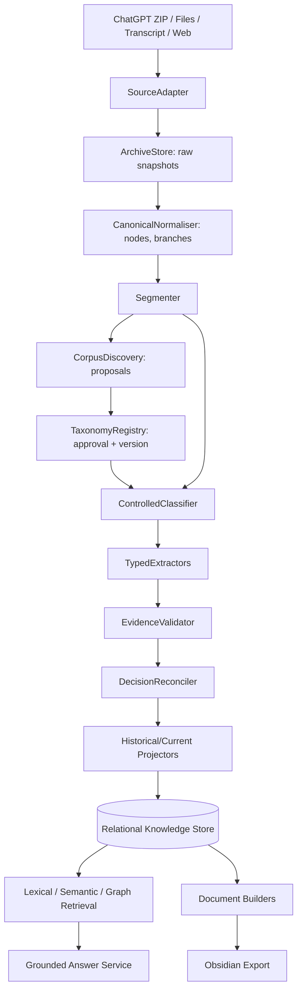

# System Architecture, Interfaces, Classes and Engineering Hurdles
**Style:** ports-and-adapters modular monolith. One process for MVP, queue/worker boundary if required later. Each stage consumes durable IDs and emits immutable/revisable data with explicit job status.

## 1. Logical phase/data flow


## 2. Module dependencies and contracts
```
api / cli             → application use cases
orchestration         → use cases + job contracts
services              → domain models + Protocol ports
infrastructure        → implements persistence / model / search / file ports
adapters              → external formats; cannot mutate canonical taxonomy
renderer              → read-only knowledge projections → Markdown
review                → authenticated, audited human override operations
```
Each stage defines `Input`, `Output`, `Version`, `Error` and durable checkpoint. The pipeline manager is orchestration only; it MUST NOT perform LLM extraction or taxonomy approval itself.

## 3. Classes and key functions (implementation guide)
**Method signatures are targets, not existing executable code.** Use Pydantic typed input/output DTOs; persist atomically at service boundaries. Comments define invariants.

### Domain (`knowledge_engine/domain`)
```python
class SourceArtifact(BaseModel):
    id: str; source_kind: str; native_id: str | None; owner_id: str
    # Logical external item: conversation, document or video.

class SourceSnapshot(BaseModel):
    id: str; artifact_id: str; sha256: str; original_path: str
    # NEVER overwrite bytes for an existing snapshot_id.

class ContentNode(BaseModel):
    id: str; snapshot_id: str; parent_id: str | None
    actor: str; content_type: str; text: str | None
    # Preserve branch graph and raw payload pointer; timestamps nullable.

class ConversationThread(BaseModel):
    id: str; node_ids: list[str]; active_leaf_id: str | None

class Segment(BaseModel):
    id: str; source_id: str; node_spans: list[dict]

class TaxonomyTerm(BaseModel):
    id: str; canonical_label: str; status: str; version: str

class Classification(BaseModel):
    segment_id: str; taxonomy_version: str; term_ids: list[str]

class EvidenceRef(BaseModel):
    snapshot_id: str; node_id: str; start: int; end: int
    # Offsets are half-open over canonical immutable node text.

class KnowledgeRecord(BaseModel):
    id: str; type: str; assertion: str; actor: str; evidence: list[EvidenceRef]

class Relationship(BaseModel):
    source_id: str; kind: str; target_id: str; evidence_ids: list[str]

class DecisionTransition(BaseModel):
    previous_id: str; next_id: str; relation: str; rationale: str

class GeneratedDocument(BaseModel):
    id: str; builder_version: str; dependency_ids: list[str]
```
Use enums for statuses, record types, origin and relationship predicates. Have deterministic stable-ID helpers `stable_source_id`, `stable_node_id`, `stable_segment_id`, `fingerprint_stage`; never derive semantic identity from display title alone.

### Ingestion (`ingestion/`)
```python
class SourceAdapter(Protocol):
    def probe(self, path: Path) -> ProbeResult: ...
    def parse(self, snapshot: SourceSnapshot) -> Iterator[ImportedNode]: ...
    def report_fidelity(self, import_id: str) -> FidelityReport: ...

class ChatGPTExportAdapter:
    def discover_json_parts(self, zip_path: Path) -> list[str]: ...
    def parse_conversation_record(self, payload: dict) -> ConversationThread: ...
    def parse_message_mapping(self, mapping: dict) -> dict[str, ContentNode]: ...
    def resolve_current_node(self, payload: dict) -> str | None: ...
    def build_active_path(self, leaf_id: str, nodes: dict) -> list[str]: ...
    def enumerate_alternative_branches(self, nodes: dict) -> list[list[str]]: ...
    def collect_assets(self, zip_manifest: list[str]) -> list[AssetRef]: ...
    def emit_import_warnings(self, content: Any) -> list[ImportWarning]: ...
    # No branch flattening; unknown JSON structures preserved verbatim.

class DocumentAdapter:
    def convert(self, snapshot: SourceSnapshot) -> CanonicalDocument: ...
    # Preserve headings, tables and text location if converter supports them.

class MarkdownAdapter:
    def parse_frontmatter(self, raw: str) -> dict: ...
    def parse_blocks(self, raw: str) -> list[ContentNode]: ...

class TranscriptAdapter:
    def parse_timed_lines(self, raw: str) -> list[TranscriptCue]: ...
    # A transcript is not automatically available just because a video URL exists.

class WebPageAdapter:
    def fetch_and_sanitise(self, url: str) -> SourceSnapshot: ...
    # SSRF/redirect/size checks BEFORE fetching or parsing.

class ImportCoordinator:
    def import_path(self, path: Path, workspace_id: str) -> ImportResult: ...
    def diff_snapshot(self, artifact_id: str, hash: str) -> SnapshotDiff: ...
    def commit_batch(self, batch: list[ImportedNode]) -> None: ...
    # Batch transaction and idempotent native-ID constraints.
```

### Normalisation and segmentation (`normalisation/`)
```python
class CanonicalNormaliser:
    def normalise(self, nodes: Iterable[ImportedNode]) -> list[ContentNode]: ...
    def normalise_actor(self, raw_role: str) -> ActorRole: ...
    def retain_unknown_payload(self, node: ImportedNode) -> RawPayloadRef: ...

class CanonicalIntegrityChecker:
    def check_graph(self, nodes: list[ContentNode]) -> IntegrityReport: ...
    def check_parent_references(self, nodes: list[ContentNode]) -> list[str]: ...
    def compare_source_manifest(self, raw: SourceSnapshot, canonical: list) -> FidelityReport: ...

class ConversationSegmenter:
    def propose_boundaries(self, nodes: list[ContentNode], context: SegmentationContext) -> list[int]: ...
    def build_segments(self, nodes: list[ContentNode], boundaries: list[int]) -> list[Segment]: ...
    def split(self, segment_id: str, at_node: str) -> list[Segment]: ...
    def merge(self, segment_ids: list[str]) -> Segment: ...
    # Do not cut quoted/continued utterances without retaining context references.
```

### Corpus discovery and taxonomy (`taxonomy/`)
```python
class CorpusDiscoveryService:
    def collect_representatives(self, segments: list[Segment]) -> DiscoverySample: ...
    def cluster_candidates(self, sample: DiscoverySample) -> list[TopicCandidate]: ...
    def propose_taxonomy(self, candidates: list[TopicCandidate]) -> ProposalBatch: ...
    # Clusters are suggestions only; never mutate approved vocabulary.

class BERTopicDiscoveryBackend:
    def fit_candidates(self, texts: list[str]) -> CandidateClustering: ...

class TaxonomyRegistry:
    def get_version(self, version: str) -> TaxonomySnapshot: ...
    def resolve_alias(self, text: str, version: str) -> str | None: ...
    def propose_term(self, candidate: TopicCandidate) -> ProposalId: ...
    def approve(self, proposal_id: str, reviewer_id: str) -> TaxonomyTerm: ...
    def reject_or_merge(self, proposal_id: str, target_id: str | None) -> None: ...
    def publish_version(self) -> str: ...
    # IDs stable; classifier gets immutable published snapshot.

class ProjectRegistry:
    def resolve_project(self, name_or_alias: str) -> list[ProjectCandidate]: ...
    def propose_merge(self, source_id: str, target_id: str) -> ReviewItem: ...

class VocabularyCandidateResolver:
    def match_approved(self, text: str) -> list[TaxonomyTerm]: ...
    def create_proposals(self, unmatched: list[str]) -> list[ProposalId]: ...
```

### Classification (`classification/`)
```python
class SegmentClassifier:
    def build_context(self, segment: Segment, corpus: CorpusContext) -> ClassificationPrompt: ...
    def generate_candidate_assignments(self, segment: Segment, taxonomy: TaxonomySnapshot) -> list[Assignment]: ...
    def validate_term_ids(self, assignments: list[Assignment], taxonomy: TaxonomySnapshot) -> None: ...
    def rank_primary_secondary(self, assignments: list[Assignment]) -> Classification: ...
    def store_classification(self, result: Classification) -> None: ...
    def flag_uncertainty(self, result: Classification) -> ReviewItem | None: ...

class KeywordRanker:
    def propose_keywords(self, segment: Segment) -> list[KeywordCandidate]: ...
    def score_significance(self, keyword: str, segment: Segment) -> float: ...
    # Frequency is only one signal; weigh centrality, user focus, decisions and specificity.
```

### Typed extraction + verification (`extraction/`)
```python
class TypedExtractor(Protocol):
    def extract(self, segment: Segment, context: ExtractionContext) -> list[ProposedKnowledgeRecord]: ...

class DecisionExtractor:
    def extract(self, segment: Segment, context: ExtractionContext) -> list[ProposedKnowledgeRecord]: ...
    def distinguish_offer_from_acceptance(self, source_window: list[ContentNode]) -> SpeechAct: ...

class PreferenceExtractor:
    def extract(self, segment: Segment, context: ExtractionContext) -> list[ProposedKnowledgeRecord]: ...
    def detect_subject_scope(self, statement: str) -> Scope: ...

class RequirementExtractor: ...  # extract(), distinguish hard/soft constraint
class ActionExtractor: ...       # extract(), associate_owner_and_status
class QuestionExtractor: ...     # extract(), mark_open_or_resolved
class ArtefactExtractor: ...     # extract(), link actual asset ID or mark missing
class ReferenceExtractor: ...    # extract(), canonicalise external title/entity

class EvidenceValidator:
    def validate_offsets(self, ref: EvidenceRef) -> ValidationResult: ...
    def validate_quote_hash(self, ref: EvidenceRef) -> ValidationResult: ...
    def verify_actor(self, proposed: ProposedKnowledgeRecord) -> ValidationResult: ...
    def verify_support(self, proposed: ProposedKnowledgeRecord, source_window: list[ContentNode]) -> ValidationResult: ...
    def commit_or_queue_review(self, proposed: ProposedKnowledgeRecord) -> KnowledgeRecord | ReviewItem: ...
    # A successful JSON parse does not prove an extracted decision is true.
```

### Reconciliation (`reconciliation/`)
```python
class DuplicateResolver:
    def find_candidates(self, record: KnowledgeRecord) -> list[KnowledgeRecord]: ...
    def merge_equivalent(self, candidate_ids: list[str], reviewer_id: str | None) -> KnowledgeRecord: ...

class ContradictionDetector:
    def find_conflicts(self, record: KnowledgeRecord, scope: Scope) -> list[ConflictCandidate]: ...

class DecisionReconciler:
    def build_decision_timeline(self, project_id: str, concept_id: str) -> list[KnowledgeRecord]: ...
    def find_explicit_supersession_language(self, evidence: list[ContentNode]) -> bool: ...
    def evaluate_revision_candidate(self, earlier: KnowledgeRecord, later: KnowledgeRecord) -> ReviewItem | DecisionTransition: ...
    def create_transition(self, earlier_id: str, later_id: str, evidence: list[EvidenceRef]) -> DecisionTransition: ...
    def explain_current_state(self, project_id: str, concept_id: str) -> CurrentStateExplanation: ...
    # A later date is not proof of replacement. Reconcile by project/feature/scope.

class RelationshipResolver:
    def propose_links(self, record: KnowledgeRecord) -> list[RelationshipCandidate]: ...
    def verify_directional_link(self, link: RelationshipCandidate) -> ValidationResult: ...

class CurrentTruthProjector:
    def project(self, scope: Scope, as_of: datetime | None) -> list[CurrentKnowledgeView]: ...
    # Show conflicting/unresolved states instead of forced winner.
```

### Retrieval and QA (`retrieval/`)
```python
class LexicalIndex(Protocol):
    def upsert(self, passages: list[Passage]) -> None: ...
    def search(self, query: str, filters: SearchFilters, limit: int) -> list[ScoredHit]: ...

class EmbeddingService(Protocol):
    def embed(self, texts: list[str]) -> list[list[float]]: ...

class VectorIndex(Protocol):
    def upsert(self, indexed: list[EmbeddedPassage]) -> None: ...
    def search(self, vector: list[float], filters: SearchFilters, limit: int) -> list[ScoredHit]: ...

class QueryPlanner:
    def plan(self, user_question: str) -> RetrievalPlan: ...
    # Route exact historical decision queries to structured data, not only vector search.

class HybridRetriever:
    def retrieve(self, plan: RetrievalPlan) -> list[EvidenceBundle]: ...
    def fuse_rankings(self, ranked_lists: list[list[ScoredHit]]) -> list[ScoredHit]: ...
    def hydrate_context(self, hits: list[ScoredHit]) -> list[EvidenceBundle]: ...
    # Enforce workspace scope both before and after search/rank fusion.

class KnowledgeAnswerService:
    def answer(self, question: str, filters: SearchFilters) -> GroundedAnswer: ...
    def audit_citations(self, answer: GroundedAnswer) -> ValidationResult: ...
    # Prefer abstention over invented source references.
```

### Document generation (`rendering/`)
```python
class DocumentDependencyTracker:
    def record(self, document_id: str, record_ids: list[str]) -> None: ...
    def affected_documents(self, changed_ids: set[str]) -> set[str]: ...

class ConversationNoteBuilder:
    def build(self, conversation_id: str) -> DocumentModel: ...

class ProjectMasterBuilder:
    def build(self, project_id: str, mode: Literal['current','history','all']) -> DocumentModel: ...

class TopicMasterBuilder:
    def build(self, topic_id: str, filters: SearchFilters) -> DocumentModel: ...

class MarkdownRenderer:
    def render_frontmatter(self, properties: dict) -> str: ...
    def render_note(self, model: DocumentModel) -> str: ...
    def check_links(self, markdown: str) -> list[BrokenLink]: ...

class ObsidianExporter:
    def write_atomically(self, path: Path, content: str) -> None: ...
    def protect_user_owned_files(self, path: Path) -> None: ...
    # Generated content lives in managed dir; do not overwrite human notes.
```

### Orchestration / persistence / evaluation (`orchestration`, `infrastructure`, `evaluation`)
```python
class ProcessingPipeline:
    def run_stage(self, job: StageJob) -> StageResult: ...
    def resume(self, job_id: str) -> StageResult: ...
    def invalidate_dependents(self, stage_id: str, changed_input_ids: set[str]) -> set[str]: ...

class JobRepository(Protocol):
    def claim(self, stage_key: str) -> StageJob: ...
    def save_result(self, job_id: str, result: StageResult) -> None: ...

class RetryPolicy:
    def classify_error(self, exc: Exception) -> Literal['transient','permanent','semantic']: ...
    def should_retry(self, attempt: int, kind: str) -> bool: ...
    # Never retry a semantic ambiguity indefinitely.

class EvaluationDataset:
    def load_cases(self, version: str) -> list[GoldenCase]: ...

class EvaluationRunner:
    def run(self, stage: str, cases: list[GoldenCase]) -> MetricReport: ...
    def order_independence(self, cases: list[GoldenCase], seed: int) -> DriftReport: ...

class RegressionGate:
    def assess(self, metrics: MetricReport, thresholds: dict) -> GateDecision: ...
    # PASS / FAIL / REVIEW_REQUIRED / BLOCKED, then stop.
```

## 4. Communication/events
Prefer in-process typed events stored in an outbox table for future worker use:
| Event | Producer | Consumer | Payload |
|---|---|---|---|
| `SourceImported.v1` | ImportCoordinator | Normaliser | source/snapshot ID, hash, import warnings |
| `CanonicalReady.v1` | Normaliser | Segmenter | source ID + node range |
| `SegmentsReady.v1` | Segmenter | Classifier/discovery | segment IDs, normaliser version |
| `TaxonomyPublished.v1` | Registry | Classifier invalidator | new version, affected aliases/IDs |
| `ClassificationReady.v1` | Classifier | Extractor | segment/classification IDs |
| `KnowledgeValidated.v1` | Validator | Reconciliation/indexer | records + evidence refs |
| `KnowledgeTransitioned.v1` | Reconciler | Projectors/builders | state/relationship changes |
| `DocumentsInvalidated.v1` | Dependency tracker | Renderer | affected document IDs |
Events are at-least-once; consumers deduplicate using event ID and stage key. Database transaction commits state and outbox together.

## 5. High-risk hurdles and alternatives
| Hurdle | Primary solution | Verify with | Alternative/fallback |
|---|---|---|---|
| Export schema/unknown content | Versioned adapters + raw preservation | multiple golden export variants, manifest diff | mark unsupported, retain byte copy |
| Branching paths | explicit graph and current leaf | edited/regenerated branch fixtures | preserve graph even if active branch unavailable |
| ZIP bombs/traversal | entry count, limits, path normalisation | malicious archive tests | reject unsafe ZIP with report |
| Multi-topic drift | segmentation before classify | annotated boundary F1 | manual split/merge |
| Taxonomy vocabulary drift | approved IDs, alias resolver, version lock | shuffled-order + alias tests | review proposed term |
| Hallucinated acceptance | actor/evidence validation | forbidden-claim benchmark | review required, no confirm |
| Temporal false revision | explicit scope and causal language | hypothetical-later cases | unresolved conflict |
| Similarity over-linking | directional proof + typed edges | false-positive relationship cases | semantic `related` only |
| Source quote offset breakage | immutable canonical text/hashes | span round-trips | mark evidence stale |
| Model schema hallucinations | structured output + semantic gates | validator unit/golden | abstain/review |
| Incremental update storms | dependency DAG + fingerprint | update one project only | full rebuilding as recovery mode |
| LLM cost/latency | staged model routing/caching | cost/token budget fixture | manual/local provider mode |
| Embedding migration | provider/dimension metadata | reindex reproducibility | lexical-only mode |
| User edits overwritten | generated/user file split + atomic write | round-trip user edit test | separate output location |
| RAG citation fabrication | restricted evidence bundles/citation audit | adversarial no-evidence prompts | abstain |
| Cross-tenant leakage | enforced scope everywhere | SQL/FTS/vector/graph leakage tests | disable hosted mode |
| Deletion incomplete | derivative lineage and purge manifests | exhaustive no-access queries after deletion | quarantine all derived indexes |
| Prompt injection in source | untrusted-content boundary | malicious webpage/transcript fixtures | no tools executed by extraction model |
| Agent infinite loops | ticket gates, stop states, max attempts | workflow simulation | stop and handoff ticket blocked |

## 6. Implementation ordering
Source identity before import → provenance before extraction → governed vocabulary before classification → evidence validation before reconciliation → historical/current projections before synthesis → lexical retrieval before semantic optimisation → single-user robustness before tenancy. Every arrow is a dependency, not an optional aesthetic choice.
