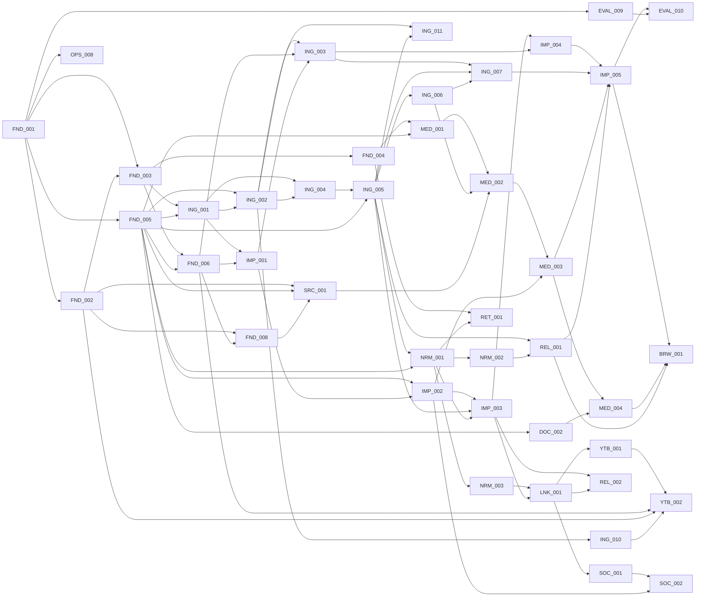

# Dependency Map

**Generated:** 2026-10-27 by the specification audit from `docs/TICKETS.csv` (122 tickets). **Status of every ticket:** `NOT_STARTED`. Nothing here is implemented.

This file answers three questions: what blocks what, in which order a coding agent should pick tickets, and which chain decides how soon each milestone can finish. The per-ticket detail (objective, acceptance, stages) stays in `docs/ROADMAP_AND_TICKETS.md`.

## 1. Integrity checks (run 2026-10-27)

Checked with a short Python script over `TICKETS.csv` and `ROADMAP_AND_TICKETS.md` (see `docs/HANDOFF_AFTER_AUDIT.md` for the exact results):

- 122 unique IDs in both files, same set and same order; title, priority, dependencies, objective and acceptance text identical between the two.
- Every dependency ID exists; no self-dependencies.
- The graph is acyclic (Kahn topological sort consumed all 122 nodes).
- In both files, every blocker appears before its dependents.

## 2. How to pick the next ticket

1. Work milestone by milestone (M1 before M2, and so on). A later milestone's ticket may start early only if all its blockers are `VERIFIED` and the owner approved it.
2. Within a milestone, take the first ticket in the order below whose blockers are all `VERIFIED`.
3. One ticket at a time unless the approved plan bundles a slice (see `IMPLEMENTATION_PLAN.md` §6).

## 3. Critical paths (longest blocker chains, counted in tickets)

- **Gate G1 source browsing** (12 tickets): `FND-001` → `FND-002` → `FND-003` → `ING-001` → `ING-002` → `ING-004` → `ING-005` → `NRM-001` → `IMP-003` → `IMP-004` → `IMP-005` → `BRW-001`
- **Gate G1 batch smoke** (12 tickets): `FND-001` → `FND-002` → `FND-003` → `ING-001` → `ING-002` → `ING-004` → `ING-005` → `NRM-001` → `IMP-003` → `IMP-004` → `IMP-005` → `EVAL-010`
- **Gate G2 structural relationships** (11 tickets): `FND-001` → `FND-002` → `FND-003` → `ING-001` → `ING-002` → `ING-004` → `ING-005` → `NRM-001` → `NRM-003` → `LNK-001` → `REL-002`
- **Gate G3 extraction** (18 tickets): `FND-001` → `FND-002` → `FND-003` → `ING-001` → `ING-002` → `ING-004` → `ING-005` → `NRM-001` → `NRM-002` → `NRM-004` → `CLS-001` → `CLS-002` → `CLS-004` → `EXT-001` → `EXT-002` → `EXT-003` → `EXT-007` → `EXT-008`
- **Gate G4 Obsidian export** (25 tickets): `FND-001` → `FND-002` → `FND-003` → `ING-001` → `ING-002` → `ING-004` → `ING-005` → `NRM-001` → `NRM-002` → `NRM-004` → `CLS-001` → `CLS-002` → `CLS-004` → `EXT-001` → `EXT-002` → `EXT-003` → `EXT-007` → `REC-001` → `REC-003` → `REC-004` → `REC-005` → `REC-006` → `RET-005` → `DOC-005` → `DOC-006`
- **Gate G4 grounded answers** (24 tickets): `FND-001` → `FND-002` → `FND-003` → `ING-001` → `ING-002` → `ING-004` → `ING-005` → `NRM-001` → `NRM-002` → `NRM-004` → `CLS-001` → `CLS-002` → `CLS-004` → `EXT-001` → `EXT-002` → `EXT-003` → `EXT-007` → `REC-001` → `REC-003` → `REC-004` → `REC-005` → `REC-006` → `RET-005` → `RET-007`
- **Gate G4 release gate** (27 tickets): `FND-001` → `FND-002` → `FND-003` → `ING-001` → `ING-002` → `ING-004` → `ING-005` → `NRM-001` → `NRM-002` → `NRM-004` → `CLS-001` → `CLS-002` → `CLS-004` → `EXT-001` → `EXT-002` → `EXT-003` → `EXT-007` → `REC-001` → `REC-003` → `REC-004` → `REC-005` → `REC-006` → `RET-005` → `DOC-005` → `DOC-006` → `EVAL-006` → `EVAL-007`

## 4. Milestones in execution order

`new` = added by this audit. `amended` = existing ticket whose scope or blockers changed (see `docs/reviews/SPEC_CHANGELOG.md`).

### M1 — Source-fidelity slice (G1) — 33 tickets

| # | Ticket | Title | P | Blocked by | Audit |
|---|---|---|---|---|---|
| 1 | `FND-001` | Bootstrap Python repository and tool configuration | P0 | — | amended |
| 2 | `FND-002` | Environment and settings manager | P0 | FND-001 | amended |
| 3 | `FND-003` | Relational persistence interface and SQLite engine | P0 | FND-001, FND-002 |  |
| 4 | `FND-004` | Alembic migration baseline | P0 | FND-003 |  |
| 5 | `FND-005` | Domain models and stable identifiers | P0 | FND-001 | amended |
| 6 | `FND-006` | Processing jobs and fingerprint keys | P0 | FND-003, FND-005 |  |
| 7 | `FND-008` | CLI skeleton and error/exit contracts | P0 | FND-002, FND-006 |  |
| 8 | `OPS-008` | Raw/private data Git guard and fixture redaction check | P0 | FND-001 | new |
| 9 | `EVAL-009` | Synthetic source-fidelity fixture suite and scale generator | P0 | FND-001 | new |
| 10 | `ING-001` | Secure archive storage and checksums | P0 | FND-003, FND-005 | amended |
| 11 | `SRC-001` | Read-only raw source inventory and guard | P0 | FND-002, FND-005, FND-008 | new |
| 12 | `ING-002` | SourceAdapter protocol and import manifests | P0 | FND-005, ING-001 |  |
| 13 | `IMP-001` | ImportBatch and source-file snapshot ledger | P0 | ING-001, FND-006 | new |
| 14 | `ING-003` | ImportCoordinator and source deduplication | P0 | ING-002, FND-006, IMP-001 | amended |
| 15 | `ING-004` | ChatGPT ZIP layout discovery | P0 | ING-001, ING-002 | amended |
| 16 | `ING-005` | ChatGPT message-graph parsing | P0 | ING-004, FND-005 | amended |
| 17 | `ING-006` | ChatGPT content and attachment parser | P0 | ING-005 | amended |
| 18 | `ING-011` | ChatGPT split-wrapper directory adapter | P0 | ING-002, ING-005 | new |
| 19 | `ING-007` | ChatGPT import integrity and audit manifest | P0 | ING-003, ING-005, ING-006 | amended |
| 20 | `NRM-001` | Canonical node normalization contract | P0 | ING-005, FND-005 | amended |
| 21 | `NRM-002` | Conversation graph integrity checker | P0 | NRM-001 |  |
| 22 | `REL-001` | Native branch classification and path enumeration | P0 | ING-005, NRM-002 | new |
| 23 | `IMP-002` | Logical identity resolver for conversations, messages and assets | P0 | FND-005, IMP-001 | new |
| 24 | `IMP-003` | Message revision and graph delta engine | P0 | IMP-002, ING-005, NRM-001 | new |
| 25 | `IMP-004` | Transactional idempotent commit, resume and import locking | P0 | IMP-003, ING-003 | new |
| 26 | `MED-001` | Media blob, asset and occurrence model | P0 | FND-004, FND-005 | new |
| 27 | `MED-002` | Asset pointer resolver | P0 | MED-001, ING-006, SRC-001 | new |
| 28 | `MED-003` | Content-addressed media dedup and occurrence persistence | P0 | MED-002, IMP-002 | new |
| 29 | `IMP-005` | Import delta report and regeneration footprint | P0 | IMP-004, ING-007, MED-003, REL-001 | new |
| 30 | `EVAL-010` | Import batch-scale smoke tests at 50 and 100 conversations | P0 | IMP-005, EVAL-009 | new |
| 31 | `DOC-002` | Deterministic Markdown/YAML renderer | P0 | FND-005 | amended |
| 32 | `MED-004` | Safe media paths and Obsidian embeds | P0 | MED-003, DOC-002 | new |
| 33 | `BRW-001` | Source-level conversation browser (CLI and Markdown) | P0 | IMP-005, MED-004, REL-001 | new |

### M2 — Link, YouTube, social and structural-relationship registries (G2) — 9 tickets

| # | Ticket | Title | P | Blocked by | Audit |
|---|---|---|---|---|---|
| 1 | `ING-010` | Transcript adapter with timestamps | P0 | ING-002 |  |
| 2 | `NRM-003` | Canonical source offset and quote hashing | P0 | NRM-001 |  |
| 3 | `LNK-001` | URL occurrence extraction and link registry | P0 | NRM-003, IMP-003 | new |
| 4 | `YTB-001` | YouTube canonicaliser and video registry | P0 | LNK-001 | new |
| 5 | `YTB-002` | Transcript acquisition jobs, status and user-supplied transcripts | P0 | YTB-001, FND-006, FND-002, ING-010 | new |
| 6 | `SOC-001` | Social account mention detection | P0 | LNK-001 | new |
| 7 | `SOC-002` | Social account registry, aliases and review | P0 | SOC-001, IMP-002 | new |
| 8 | `REL-002` | Cross-conversation relationship model and structural detectors | P0 | IMP-003, LNK-001 | new |
| 9 | `RET-001` | SQLite FTS5 lexical index and search | P0 | FND-004, NRM-001 |  |

### M3 — Semantic foundation: provider, segmentation, taxonomy, classification, extraction (G3) — 31 tickets

| # | Ticket | Title | P | Blocked by | Audit |
|---|---|---|---|---|---|
| 1 | `FND-007` | Model-provider protocol and fake provider | P0 | FND-002, FND-005 | amended |
| 2 | `FND-009` | Structured-output model provider adapter and egress policy | P0 | FND-007, FND-006 | new |
| 3 | `NRM-004` | Topical segment proposal algorithm | P0 | NRM-001, NRM-002 |  |
| 4 | `NRM-006` | Corpus sampling and segment inventory | P0 | NRM-004, ING-007 |  |
| 5 | `TAX-001` | Taxonomy and project registry schema | P0 | FND-004, FND-005 |  |
| 6 | `TAX-002` | Published taxonomy snapshot interface | P0 | TAX-001 |  |
| 7 | `TAX-003` | Alias normalization and candidate resolution | P0 | TAX-002 |  |
| 8 | `TAX-004` | Candidate proposals and manual approval | P0 | TAX-001, TAX-003 |  |
| 9 | `TAX-005` | Project identity, alias and merge proposals | P0 | TAX-001, NRM-006 |  |
| 10 | `TAX-006` | Corpus discovery optional clustering backend | P0 | NRM-006, TAX-004 |  |
| 11 | `TAX-007` | Taxonomy version diff and selective invalidation | P0 | TAX-002, TAX-004, FND-006 |  |
| 12 | `TAX-008` | Taxonomy QA, governance and review reports | P0 | TAX-003, TAX-004, TAX-005 |  |
| 13 | `CLS-001` | Classifier schema and allowed-label prompt | P0 | TAX-002, NRM-004, FND-007, FND-009 | amended |
| 14 | `CLS-002` | SegmentClassifier service | P0 | CLS-001, TAX-003 |  |
| 15 | `CLS-003` | Keyword scoring and primary/secondary ranking | P0 | CLS-002 |  |
| 16 | `CLS-004` | Classification persistence/review workflow | P0 | CLS-002, TAX-007 |  |
| 17 | `CLS-005` | Order-independence and drift diagnostic | P0 | CLS-003, CLS-004 |  |
| 18 | `EXT-001` | Typed knowledge record/review contract | P0 | FND-005, CLS-004 |  |
| 19 | `EXT-002` | Evidence validator and source-span audit | P0 | EXT-001, NRM-003 |  |
| 20 | `EXT-003` | Decision and rejection extractor | P0 | EXT-001, EXT-002 |  |
| 21 | `EXT-004` | Preference and requirement extractor | P0 | EXT-001, EXT-002 |  |
| 22 | `EXT-005` | Actions, questions and artefacts extractor | P0 | EXT-001, EXT-002, MED-003 | amended |
| 23 | `EXT-006` | External references and named entity extractor | P0 | EXT-001, EXT-002, TAX-003, LNK-001 | amended |
| 24 | `EXT-007` | Evidence promotion/review queue | P0 | EXT-002, EXT-003, EXT-004, EXT-005, EXT-006 |  |
| 25 | `EXT-008` | Extraction aggregate and processing version manager | P0 | EXT-007, FND-006, FND-009 | amended |
| 26 | `EVAL-001` | Golden corpus fixtures and annotation guide | P0 | ING-007, NRM-004 | amended |
| 27 | `EVAL-003` | Taxonomy/classification evaluation runner | P0 | EVAL-001, CLS-004 |  |
| 28 | `EVAL-004` | Knowledge extraction precision/recall | P0 | EVAL-001, EXT-007 |  |
| 29 | `OPS-001` | Structured logs, traces and cost accounting | P0 | FND-006 |  |
| 30 | `OPS-002` | Resource, timeout and queue limits | P0 | FND-006, OPS-001 | amended |
| 31 | `EVAL-011` | Semantic pipeline batch smoke tests at 50 and 100 conversations | P0 | FND-009, CLS-002, EXT-008, OPS-002 | new |

### M4 — Reconciliation, retrieval, documents, late relationships (G4) — 30 tickets

| # | Ticket | Title | P | Blocked by | Audit |
|---|---|---|---|---|---|
| 1 | `NRM-005` | Manual split/merge with immutable provenance | P0 | NRM-004 |  |
| 2 | `REC-001` | Record deduplication and equivalence proposals | P0 | EXT-007 |  |
| 3 | `REC-002` | Relationship candidate discovery | P0 | EXT-007, TAX-005 | amended |
| 4 | `REC-003` | Conflict detector by scope and time | P0 | REC-001, REC-002 |  |
| 5 | `REC-004` | Decision transition and event timeline | P0 | EXT-003, REC-003 |  |
| 6 | `REC-005` | Scope-aware supersession reconciler | P0 | REC-004 |  |
| 7 | `REC-006` | Current-state and as-of projector | P0 | REC-005 |  |
| 8 | `REC-007` | Relationship and provenance API for downstream | P0 | REC-002, REC-006 |  |
| 9 | `RET-002` | Embeddings provider and index protocol | P0 | FND-007, NRM-004 |  |
| 10 | `RET-003` | Local semantic search implementation | P0 | RET-002, FND-004 |  |
| 11 | `RET-004` | Hybrid rank fusion and structured results | P0 | RET-001, RET-003 |  |
| 12 | `RET-005` | Question route planner | P0 | RET-004, REC-006 |  |
| 13 | `RET-006` | Source context hydrator and citation resolver | P0 | RET-004, EXT-002 |  |
| 14 | `RET-007` | Grounded answer service and abstention | P0 | RET-005, RET-006, FND-007 |  |
| 15 | `RET-008` | Retrieval benchmarks and tuning report | P0 | RET-007 |  |
| 16 | `DOC-001` | Document model and dependency tracking | P0 | REC-006, EXT-007 |  |
| 17 | `DOC-003` | Individual conversation knowledge notes | P0 | DOC-002, CLS-004, MED-004, REL-002, YTB-001, SOC-002 | amended |
| 18 | `DOC-004` | Project master/current-vs-history generator | P0 | DOC-002, REC-006 |  |
| 19 | `DOC-005` | Topic master generator and selectors | P0 | DOC-002, RET-005 |  |
| 20 | `DOC-006` | Obsidian safe export and incremental regeneration | P0 | DOC-003, DOC-004, DOC-005, DOC-001, MED-004 | amended |
| 21 | `IMP-006` | Human corrections survive incremental reprocessing | P0 | IMP-003, NRM-005, CLS-004, EXT-007 | new |
| 22 | `REL-003` | Semantic and project relatedness candidates | P0 | REL-002, RET-003, TAX-005 | new |
| 23 | `REL-004` | Relationship review, notes and retrieval exposure | P0 | REL-002, DOC-003, RET-006 | new |
| 24 | `YTB-003` | Transcript cue linking, search and video notes | P1 | YTB-002, RET-001, DOC-002 | new |
| 25 | `SOC-003` | Social account registry notes | P1 | SOC-002, DOC-002 | new |
| 26 | `EVAL-002` | Parser/import fidelity evaluation | P0 | EVAL-001, ING-007, EVAL-009, IMP-005 | amended |
| 27 | `EVAL-005` | Temporal/current-state benchmark | P0 | EVAL-001, REC-006 |  |
| 28 | `EVAL-006` | End-to-end fixture and Obsidian golden | P0 | EVAL-002, DOC-006, BRW-001 |  |
| 29 | `EVAL-007` | Regression gate/report and finite stop policy | P0 | EVAL-003, EVAL-004, EVAL-005, EVAL-006 |  |
| 30 | `EVAL-008` | Shuffled-order and repeated-run variance test | P0 | CLS-005, EVAL-007 |  |

### M5 — Operations hardening, API, extra adapters (G5) — 12 tickets

| # | Ticket | Title | P | Blocked by | Audit |
|---|---|---|---|---|---|
| 1 | `ING-008` | Markdown/plain text adapter | P0 | ING-002 |  |
| 2 | `ING-009` | Structured file adapter foundation | P0 | ING-002 |  |
| 3 | `API-001` | FastAPI skeleton and dependency overrides | P0 | FND-006, FND-008 |  |
| 4 | `API-002` | Import and job status endpoints | P0 | API-001, ING-007 |  |
| 5 | `API-003` | Taxonomy/review/knowledge endpoints | P0 | API-001, TAX-008, EXT-007 |  |
| 6 | `API-004` | Search/answer/timeline endpoints | P0 | API-001, RET-007, REC-007 |  |
| 7 | `API-005` | Document build/export endpoints | P0 | API-001, DOC-006 |  |
| 8 | `OPS-003` | Local backups and verified restore | P0 | FND-004, ING-001 |  |
| 9 | `OPS-004` | Data deletion and downstream purge | P0 | DOC-006, RET-004, OPS-003, MED-003, YTB-002, SOC-002 | amended |
| 10 | `OPS-005` | CI pipeline with scoped quality gates | P0 | EVAL-007, OPS-002 |  |
| 11 | `OPS-006` | Privacy and prompt injection hardening | P0 | ING-004, RET-007, OPS-004 |  |
| 12 | `OPS-007` | Packaging, upgrade and release process | P0 | OPS-003, OPS-005 |  |

### M6 — Integrations and productisation (P1/P2, G6) — 7 tickets

| # | Ticket | Title | P | Blocked by | Audit |
|---|---|---|---|---|---|
| 1 | `PROD-001` | PostgreSQL migration proof-of-concept | P1 | FND-004, OPS-007 |  |
| 2 | `PROD-002` | Accounts/workspaces and role-based access | P1 | PROD-001, API-003 |  |
| 3 | `PROD-003` | Tenant isolation through all retrieval/exports | P1 | PROD-002, RET-007, DOC-006 |  |
| 4 | `PROD-004` | Deployment, security review and retention policies | P1 | PROD-003, OPS-006 |  |
| 5 | `INT-001` | Safe website ingestion connector | P1 | ING-002, OPS-006 |  |
| 6 | `INT-002` | YouTube transcript input workflow | P1 | ING-010, INT-001, YTB-002 | amended |
| 7 | `INT-003` | Watched folders and incremental source monitoring | P1 | ING-003, DOC-006, OPS-002 |  |

## 5. M1 and M2 graph

## 6. Reverse dependencies (what each ticket unblocks)

| Ticket | Milestone | Unblocks |
|---|---|---|
| `FND-001` | M1 | FND-002, FND-003, FND-005, OPS-008, EVAL-009 |
| `FND-002` | M1 | FND-003, FND-007, FND-008, SRC-001, YTB-002 |
| `FND-003` | M1 | FND-004, FND-006, ING-001 |
| `FND-004` | M1 | MED-001, TAX-001, RET-001, RET-003, OPS-003, PROD-001 |
| `FND-005` | M1 | FND-006, FND-007, ING-001, SRC-001, ING-002, ING-005, NRM-001, IMP-002, MED-001, TAX-001, EXT-001, DOC-002 |
| `FND-006` | M1 | FND-008, FND-009, IMP-001, ING-003, YTB-002, TAX-007, EXT-008, API-001, OPS-001, OPS-002 |
| `FND-007` | M3 | FND-009, CLS-001, RET-002, RET-007 |
| `FND-008` | M1 | SRC-001, API-001 |
| `FND-009` | M3 | CLS-001, EXT-008, EVAL-011 |
| `OPS-008` | M1 | — |
| `EVAL-009` | M1 | EVAL-010, EVAL-002 |
| `ING-001` | M1 | ING-002, IMP-001, ING-004, OPS-003 |
| `SRC-001` | M1 | MED-002 |
| `ING-002` | M1 | ING-003, ING-004, ING-011, ING-008, ING-009, ING-010, INT-001 |
| `IMP-001` | M1 | ING-003, IMP-002 |
| `ING-003` | M1 | ING-007, IMP-004, INT-003 |
| `ING-004` | M1 | ING-005, OPS-006 |
| `ING-005` | M1 | ING-006, ING-011, ING-007, NRM-001, REL-001, IMP-003 |
| `ING-006` | M1 | ING-007, MED-002 |
| `ING-011` | M1 | — |
| `ING-007` | M1 | NRM-006, IMP-005, EVAL-001, EVAL-002, API-002 |
| `ING-008` | M5 | — |
| `ING-009` | M5 | — |
| `ING-010` | M2 | YTB-002, INT-002 |
| `NRM-001` | M1 | NRM-002, NRM-003, NRM-004, IMP-003, RET-001 |
| `NRM-002` | M1 | NRM-004, REL-001 |
| `NRM-003` | M2 | LNK-001, EXT-002 |
| `NRM-004` | M3 | NRM-005, NRM-006, CLS-001, RET-002, EVAL-001 |
| `NRM-005` | M4 | IMP-006 |
| `NRM-006` | M3 | TAX-005, TAX-006 |
| `REL-001` | M1 | IMP-005, BRW-001 |
| `IMP-002` | M1 | IMP-003, MED-003, SOC-002 |
| `IMP-003` | M1 | IMP-004, LNK-001, REL-002, IMP-006 |
| `IMP-004` | M1 | IMP-005 |
| `MED-001` | M1 | MED-002 |
| `MED-002` | M1 | MED-003 |
| `MED-003` | M1 | IMP-005, EXT-005, MED-004, OPS-004 |
| `IMP-005` | M1 | EVAL-010, BRW-001, EVAL-002 |
| `EVAL-010` | M1 | — |
| `LNK-001` | M2 | YTB-001, SOC-001, REL-002, EXT-006 |
| `YTB-001` | M2 | YTB-002, DOC-003 |
| `YTB-002` | M2 | YTB-003, OPS-004, INT-002 |
| `SOC-001` | M2 | SOC-002 |
| `SOC-002` | M2 | DOC-003, SOC-003, OPS-004 |
| `REL-002` | M2 | DOC-003, REL-003, REL-004 |
| `TAX-001` | M3 | TAX-002, TAX-004, TAX-005 |
| `TAX-002` | M3 | TAX-003, TAX-007, CLS-001 |
| `TAX-003` | M3 | TAX-004, TAX-008, CLS-002, EXT-006 |
| `TAX-004` | M3 | TAX-006, TAX-007, TAX-008 |
| `TAX-005` | M3 | TAX-008, REC-002, REL-003 |
| `TAX-006` | M3 | — |
| `TAX-007` | M3 | CLS-004 |
| `TAX-008` | M3 | API-003 |
| `CLS-001` | M3 | CLS-002 |
| `CLS-002` | M3 | CLS-003, CLS-004, EVAL-011 |
| `CLS-003` | M3 | CLS-005 |
| `CLS-004` | M3 | CLS-005, EXT-001, DOC-003, IMP-006, EVAL-003 |
| `CLS-005` | M3 | EVAL-008 |
| `EXT-001` | M3 | EXT-002, EXT-003, EXT-004, EXT-005, EXT-006 |
| `EXT-002` | M3 | EXT-003, EXT-004, EXT-005, EXT-006, EXT-007, RET-006 |
| `EXT-003` | M3 | EXT-007, REC-004 |
| `EXT-004` | M3 | EXT-007 |
| `EXT-005` | M3 | EXT-007 |
| `EXT-006` | M3 | EXT-007 |
| `EXT-007` | M3 | EXT-008, REC-001, REC-002, DOC-001, IMP-006, EVAL-004, API-003 |
| `EXT-008` | M3 | EVAL-011 |
| `REC-001` | M4 | REC-003 |
| `REC-002` | M4 | REC-003, REC-007 |
| `REC-003` | M4 | REC-004 |
| `REC-004` | M4 | REC-005 |
| `REC-005` | M4 | REC-006 |
| `REC-006` | M4 | REC-007, RET-005, DOC-001, DOC-004, EVAL-005 |
| `REC-007` | M4 | API-004 |
| `RET-001` | M2 | RET-004, YTB-003 |
| `RET-002` | M4 | RET-003 |
| `RET-003` | M4 | RET-004, REL-003 |
| `RET-004` | M4 | RET-005, RET-006, OPS-004 |
| `RET-005` | M4 | RET-007, DOC-005 |
| `RET-006` | M4 | RET-007, REL-004 |
| `RET-007` | M4 | RET-008, API-004, OPS-006, PROD-003 |
| `RET-008` | M4 | — |
| `DOC-001` | M4 | DOC-006 |
| `DOC-002` | M1 | MED-004, DOC-003, DOC-004, DOC-005, YTB-003, SOC-003 |
| `MED-004` | M1 | BRW-001, DOC-003, DOC-006 |
| `BRW-001` | M1 | EVAL-006 |
| `DOC-003` | M4 | DOC-006, REL-004 |
| `DOC-004` | M4 | DOC-006 |
| `DOC-005` | M4 | DOC-006 |
| `DOC-006` | M4 | EVAL-006, API-005, OPS-004, PROD-003, INT-003 |
| `IMP-006` | M4 | — |
| `REL-003` | M4 | — |
| `REL-004` | M4 | — |
| `YTB-003` | M4 | — |
| `SOC-003` | M4 | — |
| `EVAL-001` | M3 | EVAL-002, EVAL-003, EVAL-004, EVAL-005 |
| `EVAL-002` | M4 | EVAL-006 |
| `EVAL-003` | M3 | EVAL-007 |
| `EVAL-004` | M3 | EVAL-007 |
| `EVAL-005` | M4 | EVAL-007 |
| `EVAL-006` | M4 | EVAL-007 |
| `EVAL-007` | M4 | EVAL-008, OPS-005 |
| `EVAL-008` | M4 | — |
| `API-001` | M5 | API-002, API-003, API-004, API-005 |
| `API-002` | M5 | — |
| `API-003` | M5 | PROD-002 |
| `API-004` | M5 | — |
| `API-005` | M5 | — |
| `OPS-001` | M3 | OPS-002 |
| `OPS-002` | M3 | EVAL-011, OPS-005, INT-003 |
| `EVAL-011` | M3 | — |
| `OPS-003` | M5 | OPS-004, OPS-007 |
| `OPS-004` | M5 | OPS-006 |
| `OPS-005` | M5 | OPS-007 |
| `OPS-006` | M5 | PROD-004, INT-001 |
| `OPS-007` | M5 | PROD-001 |
| `PROD-001` | M6 | PROD-002 |
| `PROD-002` | M6 | PROD-003 |
| `PROD-003` | M6 | PROD-004 |
| `PROD-004` | M6 | — |
| `INT-001` | M6 | INT-002 |
| `INT-002` | M6 | — |
| `INT-003` | M6 | — |
